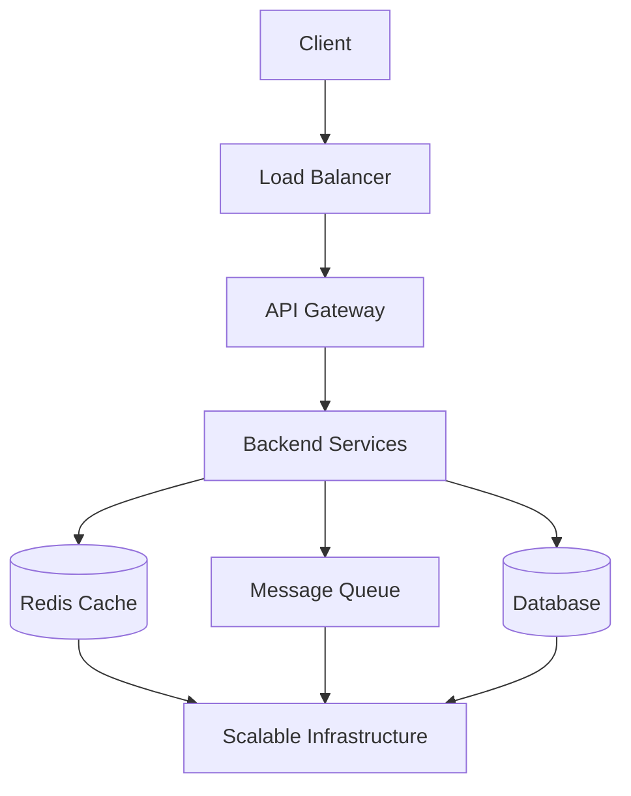
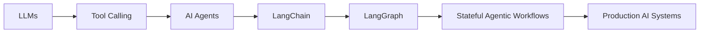

<div align="center">


<br/>

<a href="https://git.io/typing-svg">
  
</a>

<br/><br/>


<br/><br/>


</div>

<br/>

## 🧑‍💻 About Me

```yaml
name: Manish Kumar
role: Full-Stack Developer & CS Final-Year Student
focus:
  - Scalable, production-ready web applications
  - Data Structures & Algorithms mastery
  - Generative AI & Agentic AI systems
  - Low-Level & High-Level System Design
currently_building: AI-powered, distributed-systems-aware products
fun_fact: I ship faster than I sleep 🚀
```

- 🎓 Final-year **B.Tech CSE** student
- 💻 Full-Stack Developer — **MERN, Next.js & TypeScript**
- ☕ Strong foundation in **Java & Data Structures and Algorithms**
- 🧩 **650+ problems** on LeetCode · **300+** on GeeksforGeeks · **100+** on Codeforces
- 🤖 Building AI apps with **LangChain & LangGraph**
- 🏗️ Learning **Low-Level & High-Level System Design**
- 🐳 Comfortable with **Docker, Redis & backend infrastructure**
- 🏆 **Hack4Bengal 4.0 Winner** — Civic Auth Track

<br/>

## 🛠️ Tech Stack

<div align="center">

**Languages**


**Frontend**


**Backend & Infra**


</div>

<br/>

<table>
<tr>
<td valign="top" width="50%">

### 🧩 Backend
- REST APIs & API Design
- Authentication & Authorization
- JWT · Google OAuth
- Backend Architecture

### 🤖 AI & Agentic AI
- Generative AI · RAG
- **LangChain** · **LangGraph**
- AI Agents & Tool Calling
- Vector Databases
- Prompt Engineering
- Google Gemini API

</td>
<td valign="top" width="50%">

### 🏗️ System Design
- HLD & LLD
- Distributed Systems
- Microservices · API Gateway
- Load Balancing · Sharding
- Caching · Message Queues
- Rate Limiting · Fault Tolerance

### ⚡ Infrastructure
- Docker · Redis · Nginx
- BullMQ · Message Queues
- API Caching · OTP Storage
- CI/CD fundamentals

</td>
</tr>
</table>

<br/>

## 🚀 Featured Projects

<table>
<tr>
<td width="50%" valign="top">

### 🤖 AI-Powered LMS
Full-stack Learning Management System with AI-driven smart search.

**Tech:** MERN · Gemini API · Redux Toolkit · Google OAuth · Razorpay

- 🔍 AI-powered smart search using Gemini
- 🔐 Google OAuth authentication
- 💳 Razorpay payment integration
- 👨‍🎓 Student & instructor workflows

</td>
<td width="50%" valign="top">

### 🌱 GrowMint — AI Sales Platform
AI-powered platform assisting businesses with sales & marketing workflows.

**Tech:** Next.js · TypeScript · Gemini API

- 🤖 AI-powered sales tools
- 📈 Marketing assistance
- ⚡ Modern Next.js architecture

</td>
</tr>
<tr>
<td width="50%" valign="top">

### 📸 Vybe — Social Media Platform
Instagram-inspired social app with real-time features.

**Tech:** MongoDB · Express · React · Node · Socket.io · Cloudinary · JWT

- 📷 Image & post sharing, Reels
- 💬 Real-time messaging via Socket.io
- ☁️ Cloudinary media storage

</td>
<td width="50%" valign="top">

### 💰 Personal Finance Tracker
Full-stack app for tracking personal income & expenses.

**Tech:** React · Vite · Node · Express · MongoDB Atlas

- 💵 Income & expense tracking
- 📊 Financial overview dashboard
- 🔐 Secure authentication

</td>
</tr>
</table>

<br/>

## 🧠 Data Structures & Algorithms

<div align="center">


### 🏆 1050+ problems solved — 650+ LeetCode · 300+ GeeksforGeeks · 100+ Codeforces

</div>

<br/>

## 🏗️ System Design Journey



**Exploring:** Scalability · Availability · CAP Theorem · SQL vs NoSQL · Indexing · Replication · Sharding · Event-Driven Architecture · Distributed Systems

<br/>

## 🤖 Agentic AI Journey



<br/>

## 📚 Currently Learning

<div align="center">

`Advanced DSA` → `System Design` → `Scalable Backend Architecture` → `Generative AI` → `LangChain` → `LangGraph` → `Agentic AI` → `Production-Ready AI Systems`

</div>

<br/>

## 📊 GitHub Stats

<div align="center">


<br/>


<br/>


</div>

<br/>

## 🌐 Connect With Me

<div align="center">

<a href="YOUR_LINKEDIN_URL"></a>
<a href="YOUR_PORTFOLIO_URL"></a>
<a href="YOUR_LEETCODE_URL"></a>
<a href="YOUR_GFG_URL"></a>

</div>

<br/>

<div align="center">

### 💡 Build. Learn. Scale. Repeat. 🚀

⭐ Feel free to explore my repositories and connect with me!


</div>
